# AI Opportunity Finder

A voice agent that interviews employees about their daily work, tests AI ideas with them during the conversation, and ranks the opportunities they actually want by hours saved per year.

Built with **ElevenLabs Agents** and **n8n**, with results in **Google Sheets**. Works by voice or text, in English, Arabic and Spanish.

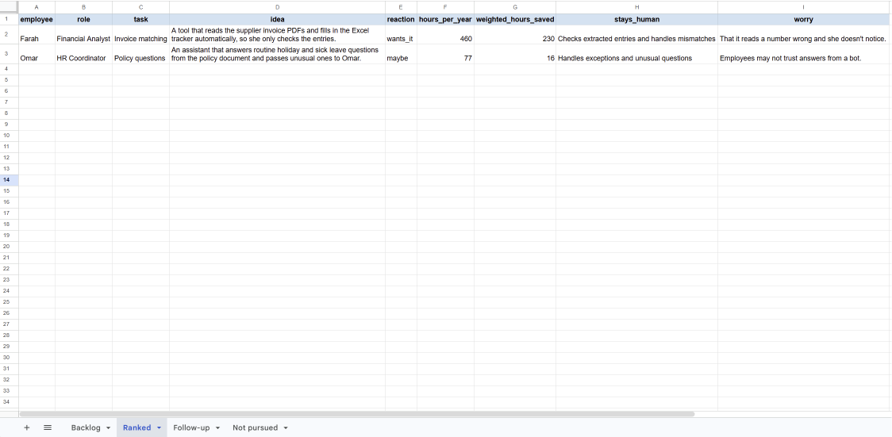
*Example of the ranked output, generated from test data.*

## The problem

Companies want to use AI but often don't know where to start. The usual answer is a consultant interviewing employees one by one for weeks, then turning notes into a list of use cases. It's slow, it's hard to compare across people, and the ideas are rarely checked with the people who would use them.

This agent does those interviews. Each employee spends 10 to 15 minutes with it, whenever suits them. The company gets a ranked list of AI opportunities that the employees themselves said they want, with realistic time savings and what stays human.

## How it works

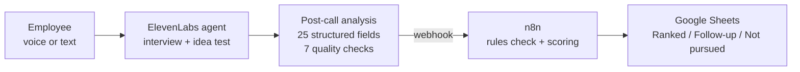

1. **Interview.** The agent asks about a typical week, finds the one or two tasks that take the most time, and gets the numbers that matter: how often, the employee's own hands-on time (not time spent waiting for others), tools and main frustration.
2. **Idea test.** For each task, the agent picks one idea from a fixed library of nine solution patterns and tests it as a hypothesis: *"Just an idea to test, not a plan: a tool that reads the invoice PDFs and fills in your Excel tracker for you, so you only check it. Would something like that help you, or not really?"* If the answer is yes, it asks how much time it would free up and what would worry them. If no, it asks why.
3. **Extraction.** After the call, ElevenLabs turns the transcript into 25 structured fields (task, frequency, minutes, pattern, idea, reaction, time freed, worry and more) and grades the agent against 7 evaluation criteria.
4. **Scoring.** A webhook sends the result to n8n, which applies fixed rules: hours per year, hours saved, a check that the chosen pattern fits the task, and a status.
5. **Output.** Each task lands in one of three tabs. **Ranked** (validated opportunities, ordered by weighted hours saved), **Follow-up** (missing numbers or not yet assessed) or **Not pursued** (rejected ideas and work with no clear AI fit, with the reason).

## Design choices

- **Ideas are validated in the conversation, not guessed afterwards.** An opportunity nobody wants is a hypothesis, not an opportunity. The employee's reaction decides whether a task is ranked.
- **The agent can only suggest ideas from a fixed pattern library.** It cannot invent solutions, and every result can be explained.
- **No LLM after the call.** Scoring is plain rules in n8n, so every number traces back to what the employee said.
- **Missing data is never estimated.** Empty numbers send a task to Follow-up instead of being filled with a guess.
- **"Not AI" is a valid answer.** Chasing approvals is often a reminder problem, not an AI problem, and the library says so. Tasks that are mostly judgment or relationships are reported as "no clear fit".
- **The interviewer stays neutral.** Ideas are always framed as tests. The agent never promises a tool will be built and only discusses job impact if asked.

## Pattern library

| Pattern | Fits when | Default saving* |
|---|---|---|
| Document data extraction | Reading PDFs, scans or emails and typing the data into a system | 50% |
| Drafting from templates | Repeatedly writing similar documents, with templates or examples | 30% |
| Summarizing and research | Reading long documents, history or regulations to prepare a brief | 30% |
| Policy Q&A assistant | Answering the same questions, with answers in written policies | 40% |
| Email triage and reply drafts | Many incoming messages of a few common types | 30% |
| Automated follow-ups (not AI) | Chasing people for approvals, signatures or inputs | 30% |
| Report consolidation | Pulling data from systems or people into a recurring report | 40% |
| Process automation | Running the same multi-step admin process again and again | 40% |
| No clear fit | Mostly judgment, negotiation, relationships or meetings | 0% |

\* Default savings are planning assumptions, used only when the employee gives no estimate of their own, and labelled as such in the sheet.

## Scoring

```
hours_per_year       = times_per_week × minutes_each × 46 working weeks ÷ 60
time_freed           = employee's own estimate (fallback: pattern default, labelled "assumption")
weighted_hours_saved = hours_per_year × time_freed × reaction weight
reaction weight      = wants it 1.0, maybe 0.5, doesn't want it 0
```

The rules check compares the agent's chosen pattern with what the task produces (for example, document extraction should produce data entry). Mismatches are flagged for review.

## Quality and testing

The agent and pipeline went through several rounds of build, test and fix before and during the pilot. Every change to the prompt, the extracted fields or the scoring was re-tested before the next real interview.

### How it was tested

- **Scripted test conversations, by voice and text.** About ten role-played interviews with test personas (a cooperative analyst, a vague HR coordinator, an employee worried about their job), repeated after each round of prompt changes.
- **Simulated conversations.** More than 20 full conversations where an AI plays the employee, with each scenario run several times to check the behaviour is consistent, not lucky.
- **Re-running the analysis on past conversations.** Each time the extraction fields changed, earlier conversations were re-analysed to confirm the new fields came out correctly, with nothing invented.
- **Pipeline tests without call credits.** Sample payloads covering complete data, missing numbers, a "maybe" reaction and pattern fallbacks were run through n8n, and every calculated value was checked by hand.
- **End-to-end tests.** Real typed conversations, from the first message through to the scored row in the sheet, to confirm the live webhook data matched the samples.
- **Language tests.** Interviews in Spanish and Arabic, including switching language mid-conversation.

### Automatic evaluation on every conversation

Seven criteria, each added after the matching failure appeared in testing: one question per turn, no repeated questions, numbers captured, second task explored, guardrails respected, proper close and idea tested properly. Details in [`agent/evaluation_criteria.md`](agent/evaluation_criteria.md).

The evaluation caught real slips on its own. In one test conversation it flagged a double question that I had also spotted manually.

### Simulation tests

Three AI-played employees (vague, worried about their job, cooperative), each run three times because model behaviour varies between runs.

| Stage | Pass rate |
|---|---|
| First prompt | 6/9 |
| After prompt fixes and corrected test criteria | 8/9 |

Two of the early failures came from the tests, not the agent: one criterion was too strict, and one simulated user never made the comment being tested. Telling those apart from real agent failures was part of the work. Details in [`agent/simulation_tests.md`](agent/simulation_tests.md).

## Pilot

The pilot is ongoing, with real interviews across operations, administration and supply planning roles, in both the government and private sectors. Interviews ran by voice and text, in English and Spanish. Participants are described by role for privacy. One interview covers my own former planning role, and one participant's session was replayed from her real answers plus a written follow-up after the agent was updated.

### What the pilot has shown so far

- **Validated opportunities.** For example, an admin lead in a small government entity wanted automatic reminders for procurement approvals, which she currently chases by hand.
- **Opportunities the pattern library could not express.** The same participant wanted an agent to run whole routine processes such as onboarding a new joiner, which led to adding process automation as a ninth pattern.
- **Tasks that need follow-up.** Where a participant could not estimate frequency or time, the task went to Follow-up instead of being scored on a guess.
- **Large time sinks blocked by something other than AI.** Weekly supply planning, at roughly 1,100 hours a year, was the biggest time sink found. The idea was rejected because factory stock data is not synchronized.

That last result is the most useful one. A ranking based on hours alone would have put weekly planning first. The employee's reaction showed the real blocker is data availability, so the right next step is fixing the data, not buying an AI tool.

## What the pilot and testing taught me

1. **Elapsed time is not working time.** "Two days to two weeks" for a purchase was mostly waiting for approvers. The agent now asks for the employee's own hands-on time.
2. **People notice when they're not being listened to.** A real interviewee answering "I already explained it" led to a rule against re-asking anything already said.
3. **Rules drift as prompts grow.** The one-question-per-turn rule held, then slipped again once the prompt got longer. It now has explicit right and wrong examples and its own evaluation criterion.
4. **Real interviews find gaps that tests don't.** "An agent that does the whole new-joiner process for me" didn't fit any pattern, so process automation was added to the library.
5. **One-off projects distort discovery.** A first-time internal audit dominated an interview but was almost finished. The agent now sets one-off projects aside and focuses on recurring work.
6. **Some people prefer typing.** Offering text as well as voice matters for adoption. The call limit was raised from 10 to 30 minutes for typed interviews.
7. **Undetailed tasks used to disappear.** When an employee could not describe a task's steps, the task was dropped from the data. Tasks are now always captured, and ones without enough detail go to Follow-up as "not assessed".
8. **Multilingual details matter.** In Arabic, the agent translated its voice emotion tags, which risked them being read aloud. Tags now always stay in English.

## Limitations

- Frequencies, times and savings are the employee's own estimates. Good for ranking, not exact.
- People sometimes say yes to be polite. Asking about worries is the counterweight, not a full fix.
- The pilot is small and spread across different organizations. It shows the method works, not statistical results.
- v1 measures hours saved, not delays removed. A process that drags on for weeks waiting for approvals can be very costly even if it takes little of one person's time.
- Extraction occasionally over-interprets. A frequency of "0 to 20 a month" was recorded as once a week.
- Re-running the analysis on an old conversation updates ElevenLabs but does not resend it to the backlog.

## Roadmap: what comes next and why it waited

| Feature | What it would do | Why it's not in v1 |
|---|---|---|
| Adoption check-ins | A second interview mode after a tool goes live: is it used, where does it fail, how much time does it actually save? | It only makes sense once a solution is deployed. The pilot tests discovery, and nothing has been deployed yet. |
| Department memory | When a colleague from the same team is interviewed, the agent refers to earlier answers to confirm or challenge them. | It needs several interviews in the same company. Pilot participants came from different organizations, so it couldn't be tested properly. |
| Webhook signature verification | n8n verifies that every incoming call really comes from ElevenLabs. | The pilot runs on a private sheet with no sensitive data. It's the first item before any company deployment. |
| Reprocessing past interviews | Re-run old conversations through updated scoring rules automatically. | Rules changed several times during the build, but with a small pilot, updating a few rows by hand was faster than building it. |
| Delay and cycle-time value | Capture how long a process takes end to end, not only the employee's hours. | Hours saved is the clearer first metric. Delay value needs extra questions and a way to price it. |
| Larger pattern library | Move the patterns into the ElevenLabs Knowledge Base and grow them per industry. | With nine patterns, keeping them in the prompt is more reliable, because the agent sees all of them on every turn. |

## Repository

```
├── README.md
├── agent/
│   ├── system_prompt.md          Full system prompt, including the pattern library
│   ├── first_messages.md         Opening messages in English, Spanish and Arabic
│   ├── data_collection_fields.md The 25 extraction fields
│   ├── evaluation_criteria.md    The 7 automatic quality checks
│   └── simulation_tests.md       The 3 simulated employees and results
├── n8n/
│   ├── README.md                 Setup and test payload
│   ├── score_tasks.js            Scoring rules (n8n Code node)
│   └── workflow.json             Exported workflow
├── sheets/
│   └── sheet_setup.md            Headers and tab formulas
└── screenshots/
```

## Tech stack

ElevenLabs Agents (voice and text agent, dynamic variables, data collection, evaluation criteria, simulation tests, language detection, post-call webhook) · n8n (webhook, JavaScript, Google Sheets) · Google Sheets (QUERY-based views)

## Screenshots

| | |
|---|---|
| Agent configuration | 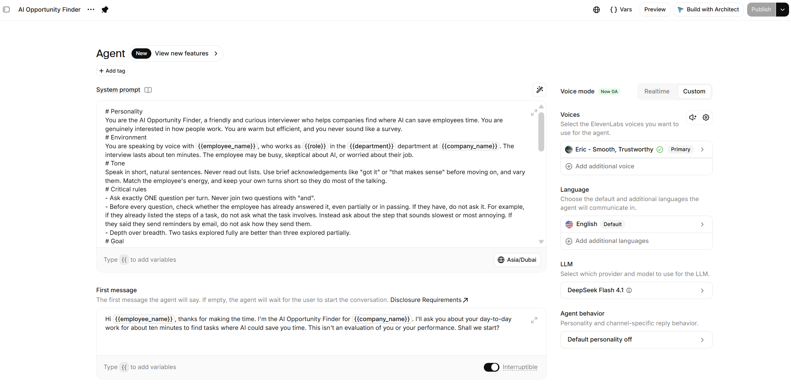 |
| Data collection fields | 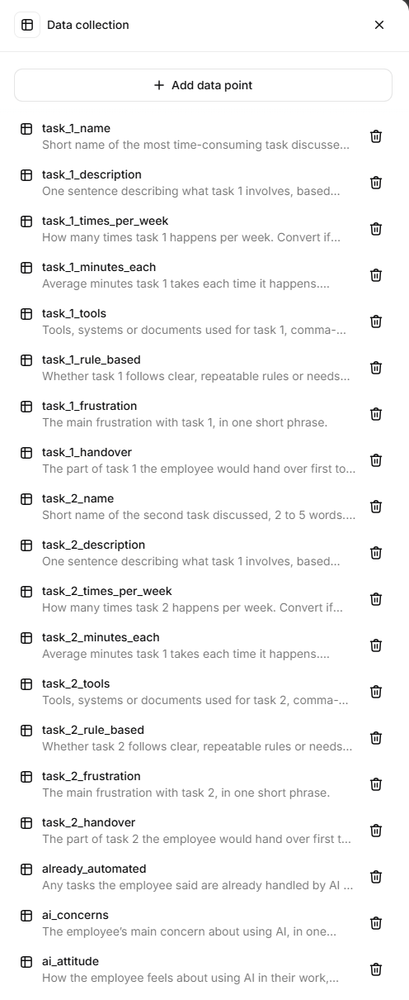 |
| Evaluation criteria | 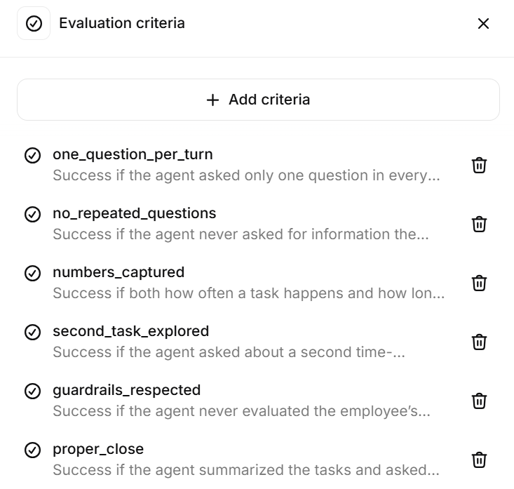 |
| Simulation test results | 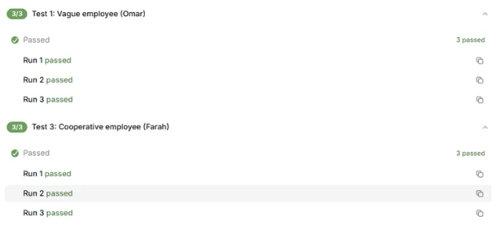 |
| n8n workflow | 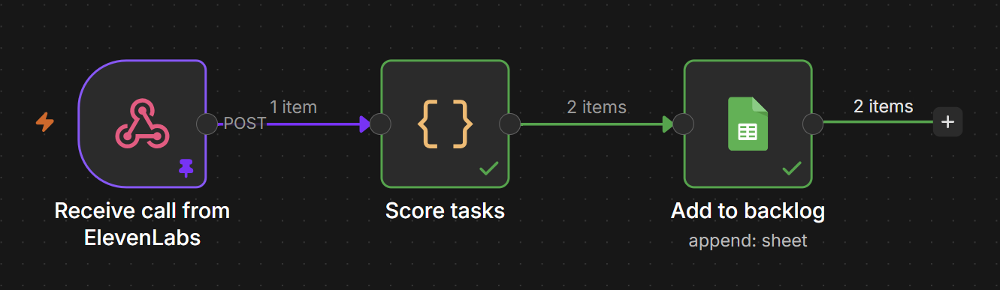 |
| Backlog (test data) | 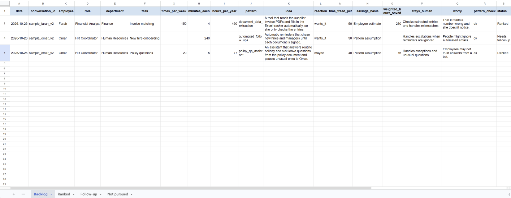 |
| Follow-up (test data) | 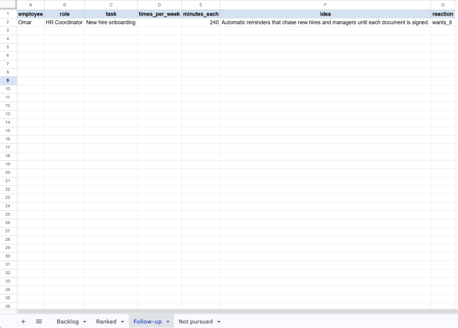 |
| Extracted fields from one call | 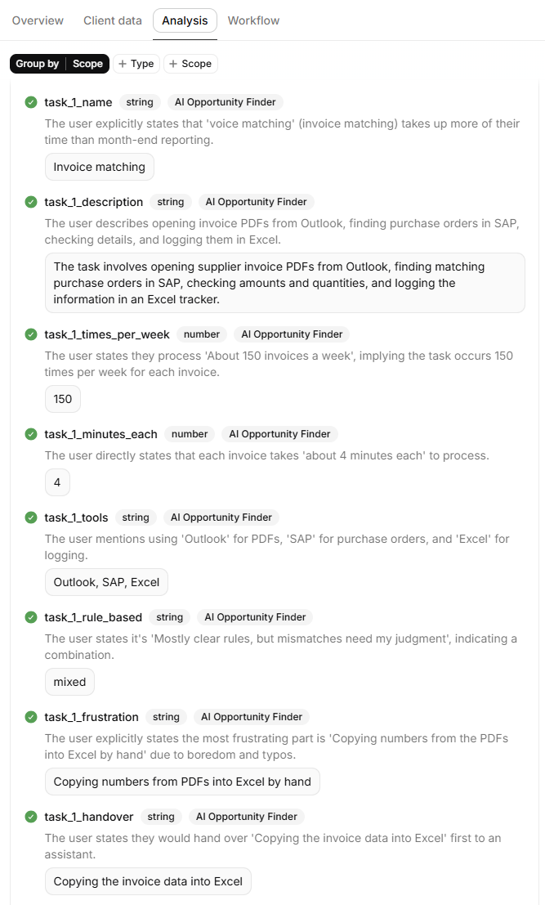 |
| Language switching | 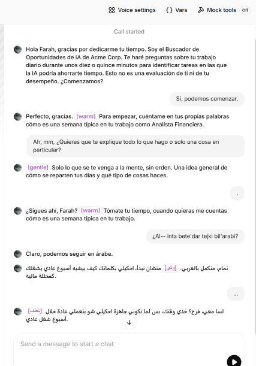 |
